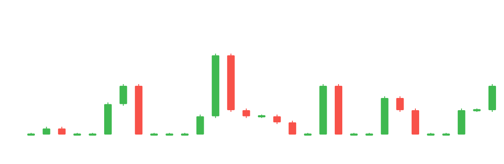

<!-- ⚠️ Replace every santoshpoudelx below with your real GitHub username -->

<div align="center">



<br/>

<a href="https://github.com/santoshpoudelx">
  
</a>

<br/>

<a href="https://santosh2.com.np"></a>
<a href="https://dexbotx.vercel.app"></a>
<a href="https://github.com/santoshpoudelx"></a>

</div>

<br/>

## 👨‍💻 About Me

```js
const santosh = {
  name: "Santosh Poudel",
  role: "Full-Stack Web Developer",
  location: "Nepal 🇳🇵",
  building: ["SaaS products", "DexBotX - a Discord bot that runs moderation on its own"],
  learning: ["Ethereum", "Sui", "Solana"],
  currentFocus: "shipping clean, fast, scalable web apps",
  funFact: "I teach bots to keep Discord servers peaceful ☮️",
};
```

<br/>

## 🛠️ Tech Stack

<div align="center">


<br/>


<br/><br/>


</div>

<br/>

## 🚀 Featured Projects

<table>
  <tr>
    <td width="50%" valign="top">
      <h3>🤖 DexBotX</h3>
      <p>A Discord moderation bot that manages a server on its own - keeping communities safe and active without a human babysitting it.</p>
      <p>
        
        
        
      </p>
      <a href="https://dexbotx.vercel.app">🔗 Visit DexBotX</a>
    </td>
    <td width="50%" valign="top">
      <h3>🌐 Personal Portfolio</h3>
      <p>My personal site showcasing projects, skills, and ways to get in touch.</p>
      <p>
        
        
      </p>
      <a href="https://santosh2.com.np">🔗 Visit Portfolio</a>
    </td>
  </tr>
  <tr>
    <td width="50%" valign="top">
      <h3>☁️ SaaS Product</h3>
      <p>Describe your SaaS here - what problem it solves and who it is for.</p>
      <p>
        
        
      </p>
      <a href="https://github.com/santoshpoudelx/YOUR_REPO">🔗 View Repo</a>
    </td>
    <td width="50%" valign="top">
      <h3>⛓️ On-Chain Experiments</h3>
      <p>Smart contracts and dApp experiments across Ethereum, Sui and Solana as I learn the ecosystems.</p>
      <p>
        
        
      </p>
      <a href="https://github.com/santoshpoudelx?tab=repositories">🔗 Browse Repos</a>
    </td>
  </tr>
</table>

<br/>

## 📊 GitHub Stats

<div align="center">

<table width="100%">
  <tr>
    <td align="center" valign="top" width="50%">
      
    </td>
    <td align="center" valign="top" width="50%">
      <p><strong>Top languages</strong></p>
      
    </td>
  </tr>
</table>

</div>

<br/>

## 📈 Contribution Activity

<div align="center">



</div>

<br/>

## 🐍 Contribution Snake

<div align="center">

<picture>
  <source media="(prefers-color-scheme: dark)" srcset="https://raw.githubusercontent.com/santoshpoudelx/santoshpoudelx/output/github-snake-dark.svg"/>
  <source media="(prefers-color-scheme: light)" srcset="https://raw.githubusercontent.com/santoshpoudelx/santoshpoudelx/output/github-snake.svg"/>
  
</picture>

</div>

<br/>

## 🏅 Badges

<div align="center">

<a href="https://github.com/santoshpoudelx?tab=followers"></a>
<a href="https://github.com/santoshpoudelx?tab=repositories"></a>
<a href="https://github.com/santoshpoudelx/santoshpoudelx"></a>
<a href="https://github.com/santoshpoudelx/santoshpoudelx"></a>

</div>

<br/>

## 🤝 Let's Connect

<div align="center">

<a href="https://santosh2.com.np"></a>
<a href="https://github.com/santoshpoudelx"></a>
<a href="https://linkedin.com/in/YOUR_LINKEDIN"></a>
<a href="https://twitter.com/YOUR_TWITTER"></a>
<a href="mailto:hi@santoshpoudel06.com.np"></a>

<br/><br/>


</div>
